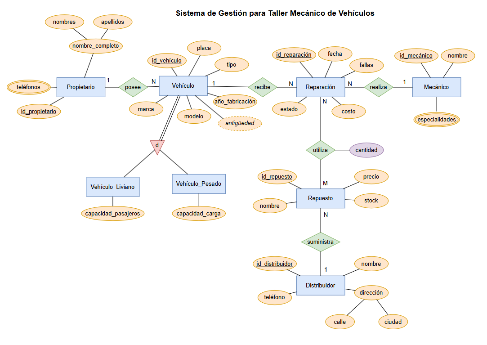
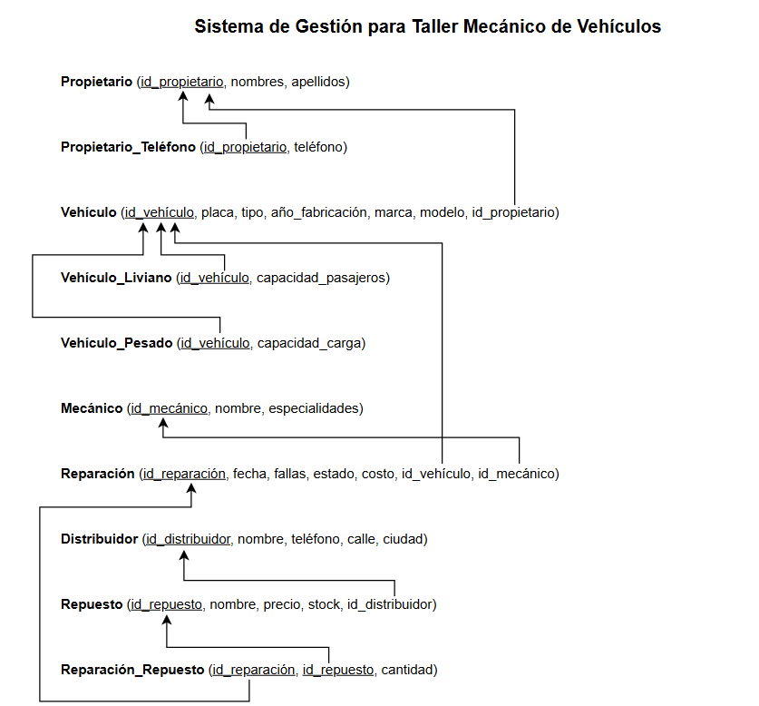
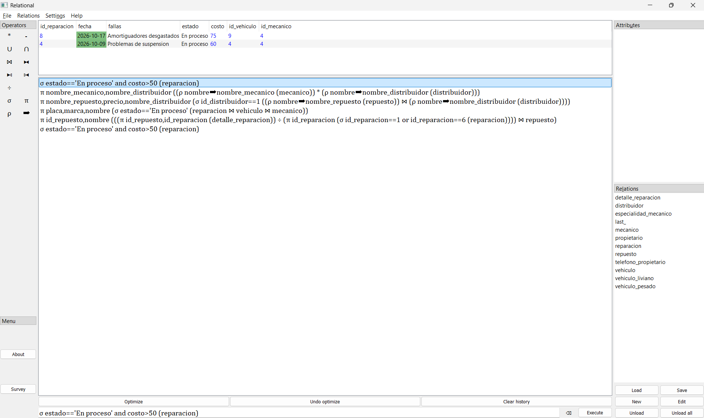
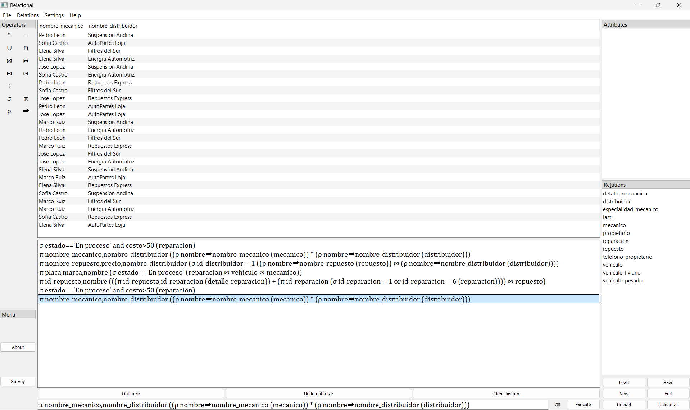
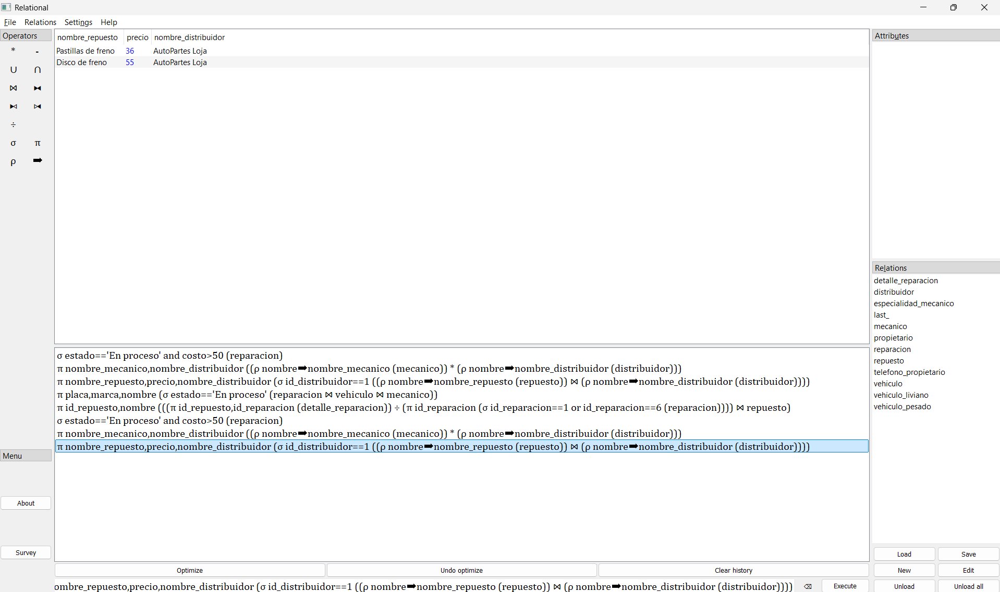
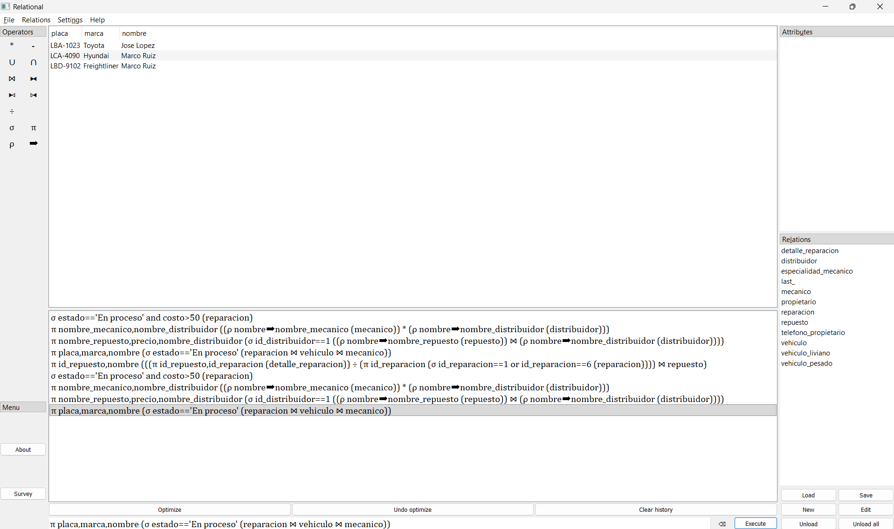
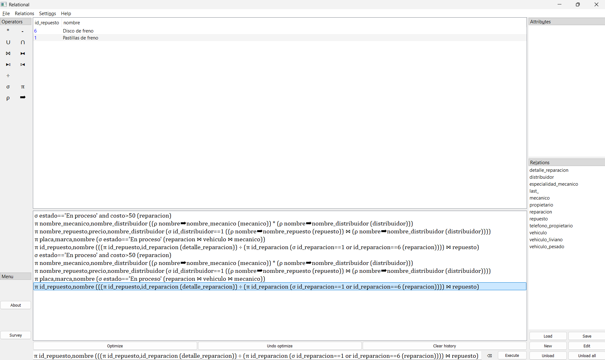

<p align="center">
  
</p>

<p align="center"><strong>FEIRNNR - Carrera de Computación</strong></p>

# INFORME DE FIN DE UNIDAD

## Datos Generales

| Dato | Información |
| --- | --- |
| Asignatura | Base de datos |
| Ciclo | 3 A |
| Unidad | 1 |
| Resultado de aprendizaje de la unidad | Modela bases de datos de problemas reales, bajo los principios de solidaridad, transparencia, responsabilidad y honestidad. |
| Nombre del Docente | Edwin René Guamán Quinche |
| Fecha | 09/11/2026 |
| Enlace de Git | https://github.com/Jullxn28/CICLO3_ProyectoU1_BaseDeDatos_JulianMerino.git |
| Nombres y apellidos del estudiante | Paolo Julián Merino Guamán |

## 1. TÍTULO

Implementación de una base de datos relacional para la gestión de reparaciones en un taller mecánico de vehículos.

## 2. CONTEXTO DEL PROBLEMA

En los talleres mecánicos dedicados al mantenimiento y reparación de automóviles, camionetas, furgonetas y camiones, es necesario administrar constantemente información relacionada con los propietarios, vehículos, mecánicos, reparaciones y repuestos utilizados.

Muchos talleres pequeños realizan estos registros de forma manual, mediante cuadernos o documentos independientes, lo que puede ocasionar pérdida de información, duplicación de datos y dificultades para consultar el historial de reparaciones de cada vehículo. Esta situación afecta al personal administrativo, a los mecánicos y a los propietarios, debido a que dificulta el seguimiento de los trabajos y el control de los recursos disponibles.

Ante esta problemática, surge la necesidad de contar con una base de datos que permita centralizar y relacionar la información del taller, facilitando el registro de las reparaciones, la identificación de los responsables, el control de los repuestos y la consulta de información, contribuyendo así a una gestión más organizada y eficiente.

## 3. OBJETIVOS

### 3.1. Objetivo General

Diseñar una base de datos que centralice la información de propietarios, vehículos, mecánicos, reparaciones, repuestos y distribuidores, para facilitar el registro de los servicios y la consulta de los trabajos realizados en el taller.

### 3.2. Objetivos Específicos

1. Organizar la información de los vehículos, sus propietarios y los servicios del taller mediante una estructura que defina los datos necesarios y las relaciones entre ellos.

2. Implementar las tablas y sus restricciones en SQL, incorporar registros de prueba y realizar consultas que permitan dar seguimiento a las reparaciones, identificar repuestos utilizados y obtener información útil para la gestión del taller.

## 4. MODELOS CONCEPTUALES DE BASES DE DATOS

### 4.1. Modelo Entidad-Relación (E-R)



*Figura 1. Diagrama Entidad-Relación del sistema [Sistema de Gestión para Taller Mecánico de Vehículos].*

### 4.2. Modelo Relacional

#### Tabla Propietario

| Atributo | Tipo SQL | Clave / consideración |
| --- | --- | --- |
| `id_propietario` | `VARCHAR(10)` | PK |
| `nombres` | `VARCHAR(60)` | — |
| `apellidos` | `VARCHAR(60)` | — |

#### Tabla Teléfono_Propietario

| Atributo | Tipo SQL | Clave / consideración |
| --- | --- | --- |
| `id_propietario` | `VARCHAR(10)` | PK, FK |
| `teléfono` | `VARCHAR(10)` | PK |

#### Tabla Mecánico

| Atributo | Tipo SQL | Clave / consideración |
| --- | --- | --- |
| `id_mecánico` | `VARCHAR(10)` | PK |
| `nombre` | `VARCHAR(100)` | — |

#### Tabla Especialidad_Mecánico

| Atributo | Tipo SQL | Clave / consideración |
| --- | --- | --- |
| `id_mecánico` | `VARCHAR(10)` | PK, FK |
| `especialidad` | `VARCHAR(80)` | PK |

#### Tabla Distribuidor

| Atributo | Tipo SQL | Clave / consideración |
| --- | --- | --- |
| `id_distribuidor` | `VARCHAR(10)` | PK |
| `nombre` | `VARCHAR(100)` | — |
| `teléfono` | `VARCHAR(10)` | — |
| `calle` | `VARCHAR(100)` | — |
| `ciudad` | `VARCHAR(60)` | — |

#### Tabla Vehículo

| Atributo | Tipo SQL | Clave / consideración |
| --- | --- | --- |
| `id_vehículo` | `VARCHAR(10)` | PK |
| `placa` | `VARCHAR(12)` | UQ |
| `tipo` | `VARCHAR(20)` | — |
| `marca` | `VARCHAR(50)` | — |
| `modelo` | `VARCHAR(50)` | — |
| `año_fabricación` | `INT` | — |
| `id_propietario` | `VARCHAR(10)` | FK |

#### Tabla Vehículo_Liviano

| Atributo | Tipo SQL | Clave / consideración |
| --- | --- | --- |
| `id_vehículo` | `VARCHAR(10)` | PK, FK |
| `capacidad_pasajeros` | `INT` | — |

#### Tabla Vehículo_Pesado

| Atributo | Tipo SQL | Clave / consideración |
| --- | --- | --- |
| `id_vehículo` | `VARCHAR(10)` | PK, FK |
| `capacidad_carga` | `DOUBLE` | — |

#### Tabla Repuesto

| Atributo | Tipo SQL | Clave / consideración |
| --- | --- | --- |
| `id_repuesto` | `VARCHAR(10)` | PK |
| `nombre` | `VARCHAR(100)` | — |
| `precio` | `DOUBLE` | — |
| `stock` | `INT` | — |
| `id_distribuidor` | `VARCHAR(10)` | FK |

#### Tabla Reparacion

| Atributo | Tipo SQL | Clave / consideración |
| --- | --- | --- |
| `id_reparación` | `VARCHAR(10)` | PK |
| `fecha` | `DATE` | — |
| `fallas` | `VARCHAR(250)` | — |
| `estado` | `VARCHAR(20)` | — |
| `costo` | `DOUBLE` | — |
| `id_vehículo` | `VARCHAR(10)` | FK |
| `id_mecánico` | `VARCHAR(10)` | FK |

#### Tabla Detalle_Reparación

| Atributo | Tipo SQL | Clave / consideración |
| --- | --- | --- |
| `id_reparación` | `VARCHAR(10)` | PK, FK |
| `id_repuesto` | `VARCHAR(10)` | PK, FK |
| `cantidad` | `INT` | — |

### Modelo relacional por listas



*Figura 2. Modelo Relacional sistema [Sistema de Gestión para Taller Mecánico de Vehículos].*

## 5. CÓDIGO SQL

### 5.1. Creación de Tablas (DDL)

#### Propietario

```sql
CREATE TABLE Propietario (
    id_propietario VARCHAR (10) NOT NULL,
    nombres VARCHAR (60) NOT NULL,
    apellidos VARCHAR (60) NOT NULL,
    PRIMARY KEY (id_propietario)
);
```

#### Mecánico

```sql
CREATE TABLE Mecánico (
    id_mecánico VARCHAR (10) NOT NULL,
    nombre VARCHAR (100) NOT NULL,
    PRIMARY KEY (id_mecánico)
);
```

#### Vehículo

```sql
CREATE TABLE Vehículo (
    id_vehículo VARCHAR (10) NOT NULL,
    placa VARCHAR (12) NOT NULL UNIQUE,
    tipo VARCHAR (20) NOT NULL,
    marca VARCHAR (50) NOT NULL,
    modelo VARCHAR (50) NOT NULL,
    año_fabricación INT NOT NULL,
    id_propietario VARCHAR (10) NOT NULL,
    PRIMARY KEY (id_vehículo),
    FOREIGN KEY (id_propietario) REFERENCES Propietario (id_propietario)
);
```

Se presentaron 3 ejemplos de algunas entidades de la base de datos.

### 5.2. Inserción de Datos (DML)

#### Registro Propietario

```sql
INSERT INTO `Propietario` (`id_propietario`, `nombres`, `apellidos`) VALUES
    (1, 'Ana', 'Torres'),
    (2, 'Carlos', 'Vega'),
    (3, 'Maria', 'Paredes'),
    (4, 'Luis', 'Jimenez'),
    (5, 'Diana', 'Rojas');
```

#### Registro Mecánico

```sql
INSERT INTO `Mecánico` (`id_mecánico`, `nombre`) VALUES
    (1, 'Jose Lopez'),
    (2, 'Pedro Leon'),
    (3, 'Elena Silva'),
    (4, 'Marco Ruiz'),
    (5, 'Sofia Castro');
```

#### Registro Vehículo

```sql
INSERT INTO `Vehículo` (`id_vehículo`, `placa`, `tipo`, `marca`, `modelo`, `año_fabricación`, `id_propietario`) VALUES
    (1, 'LBA-1023', 'Automovil', 'Toyota', 'Corolla', 2017, 1),
    (2, 'LCA-2045', 'Camioneta', 'Chevrolet', 'D-Max', 2022, 2),
    (3, 'LBD-3078', 'Camion', 'Hino', '300', 2018, 3),
    (4, 'LCA-4090', 'Furgoneta', 'Hyundai', 'H1', 2019, 4),
    (5, 'LBA-5012', 'Automovil', 'Kia', 'Rio', 2020, 5),
    (6, 'LBA-6099', 'Automovil', 'Mazda', '3', 2023, 1),
    (7, 'LBD-7100', 'Camion', 'Isuzu', 'NPR', 2015, 2),
    (8, 'LBD-8101', 'Camion', 'Mitsubishi', 'Fuso', 2016, 3),
    (9, 'LBD-9102', 'Camion', 'Freightliner', 'M2', 2017, 4),
    (10, 'LBD-0103', 'Camion', 'Hino', '500', 2021, 5);
```

## 6. CONSULTAS DE ÁLGEBRA RELACIONAL Y TRADUCCIÓN A SQL

### 6.1. Consulta 1 — Selección (σ)

**Objetivo:** Identificar las reparaciones que se encuentran en proceso y cuyo costo del servicio supera los 50 dólares, a fin de dar seguimiento a los trabajos pendientes.

**Álgebra relacional (Relational):**

```text
σ estado=='En proceso' and costo>50 (reparacion)
```

**SQL:**

```sql
SELECT *
FROM `Reparacion`
WHERE estado = 'En proceso' AND costo > 50;
```

**Resultado esperado:** Se mostrarán las reparaciones que cumplan simultáneamente las condiciones de estado y costo. Si no existen coincidencias, el resultado estará vacío.



*Figura 3. Resultado de la consulta 1 en Relational.*

### 6.2. Consulta 2 — Proyección y producto cartesiano (π, ×)

**Objetivo:** Obtener las posibles combinaciones entre los mecánicos y los distribuidores registrados en el taller, mostrando sus respectivos nombres.

**Álgebra relacional (Relational):**

```text
π nombre_mecanico,nombre_distribuidor ((ρ nombre➡nombre_mecanico (mecanico)) * (ρ nombre➡nombre_distribuidor (distribuidor)))
```

**SQL:**

```sql
SELECT m.nombre AS nombre_mecanico,
       d.nombre AS nombre_distribuidor
FROM `Mecánico` m
CROSS JOIN `Distribuidor` d;
```

**Resultado esperado:** Se presentarán las combinaciones posibles entre los mecánicos y los distribuidores registrados. Estas combinaciones no representan acuerdos comerciales existentes.



*Figura 4. Resultado de la consulta 2 en Relational.*

### 6.3. Consulta 3 — Selección y proyección (σ, π)

**Objetivo:** Consultar los nombres, precios y distribuidores de los repuestos suministrados por un proveedor específico del taller.

**Álgebra relacional (Relational):**

```text
π nombre_repuesto,precio,nombre_distribuidor (σ id_distribuidor==1 ((ρ nombre➡nombre_repuesto (repuesto)) ⋈ (ρ nombre➡nombre_distribuidor (distribuidor))))
```

**SQL:**

```sql
SELECT r.nombre AS nombre_repuesto, r.precio,
       d.nombre AS nombre_distribuidor
FROM `Repuesto` r
JOIN `Distribuidor` d ON r.id_distribuidor = d.id_distribuidor
WHERE d.id_distribuidor = '1';
```

**Resultado esperado:** Se obtendrán los repuestos asociados al distribuidor seleccionado, con su nombre, precio y nombre del establecimiento que los suministra.



*Figura 5. Resultado de la consulta 3 en Relational.*

### 6.4. Consulta 4 — Reunión natural (⋈)

**Objetivo:** Identificar los vehículos que tienen reparaciones en proceso y los mecánicos responsables de esos trabajos.

**Álgebra relacional (Relational):**

```text
π placa,marca,nombre (σ estado=='En proceso' (reparacion ⋈ vehiculo ⋈ mecanico))
```

**SQL:**

```sql
SELECT v.placa, v.marca, m.nombre
FROM `Reparacion` r
JOIN `Vehículo` v ON r.id_vehículo = v.id_vehículo
JOIN `Mecánico` m ON r.id_mecánico = m.id_mecánico
WHERE r.estado = 'En proceso';
```

**Resultado esperado:** Se mostrarán las placas y marcas de los vehículos con reparaciones en proceso, junto con el nombre del mecánico responsable.



*Figura 6. Resultado de la consulta 4 en Relational.*

### 6.5. Consulta 5 — División (÷)

**Objetivo:** Identificar los repuestos utilizados en todas las reparaciones seleccionadas de frenos, para reconocer los materiales compartidos entre esos trabajos.

**Álgebra relacional (Relational):**

```text
π id_repuesto,nombre (((π id_repuesto,id_reparacion (detalle_reparacion)) ÷ (π id_reparacion (σ id_reparacion==1 or id_reparacion==6 (reparacion)))) ⋈ repuesto)
```

**SQL:**

```sql
SELECT p.id_repuesto, p.nombre
FROM `Repuesto` p
JOIN `Detalle_Reparación` d ON p.id_repuesto = d.id_repuesto
WHERE d.id_reparación IN ('1', '6')
GROUP BY p.id_repuesto, p.nombre
HAVING COUNT(DISTINCT d.id_reparación) = 2;
```

**Resultado esperado:** Se identificarán los repuestos que aparecen en ambas reparaciones consideradas. Los que figuran en una sola de ellas no formarán parte del resultado.



*Figura 7. Resultado de la consulta 5 en Relational.*

## 7. CONCLUSIONES

1. La organización de la información permitió relacionar cada vehículo con su propietario y sus reparaciones, además de identificar al mecánico responsable de cada trabajo. Esta estructura facilita la consulta de antecedentes y reduce el riesgo de duplicar registros.

2. Las tablas y restricciones implementadas en SQL proporcionan un control ordenado sobre los datos de contacto, los tipos de vehículos y los repuestos utilizados. Los registros de prueba permitieron comprobar las relaciones y distinguir el costo del servicio del importe correspondiente a los materiales.

3. El álgebra relacional permitió construir consultas de distinta complejidad antes de llevarlas a SQL. La combinación de filtros, renombramiento, producto cartesiano, reuniones y división facilitó la búsqueda de reparaciones, la identificación de repuestos según sus distribuidores y la comprobación de materiales utilizados en varios trabajos.

## 8. BIBLIOGRAFÍA

[1] E. R. Guamán Quinche, «Paso Modelo E/R a Modelo Relacional», material de clase, Carrera de Computación, Universidad Nacional de Loja, Loja, Ecuador, s. f.  

[2] E. R. Guamán Quinche, «Álgebra Relacional», material de clase, Carrera de Computación, Universidad Nacional de Loja, Loja, Ecuador, s. f.  

[3] R. Elmasri y S. B. Navathe, Fundamentals of Database Systems, 7.ª ed. Pearson, 2016. [En línea]. Disponible en: https://books.google.com/books?id=Yb_uoQEACAAJ  

[4] A. Silberschatz, H. F. Korth y S. Sudarshan, Database System Concepts, 7.ª ed. McGraw-Hill, 2019. [En línea]. Disponible en: https://www.db-book.com/  

---

**Datos del taller:** [Archivos CSV](DatosTallerMecanicoCSV/).
